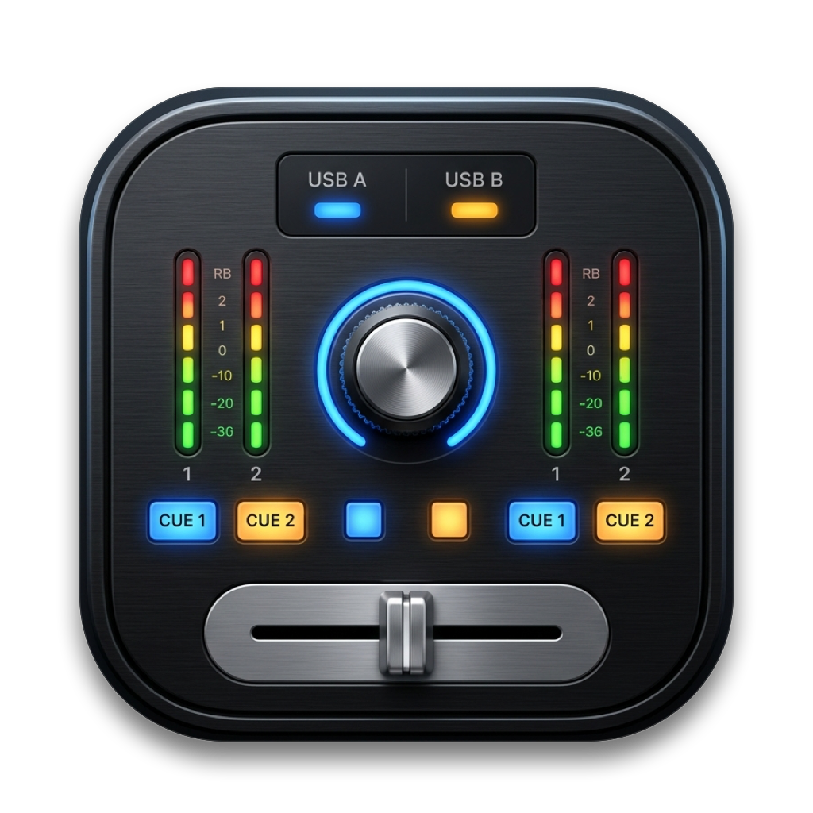
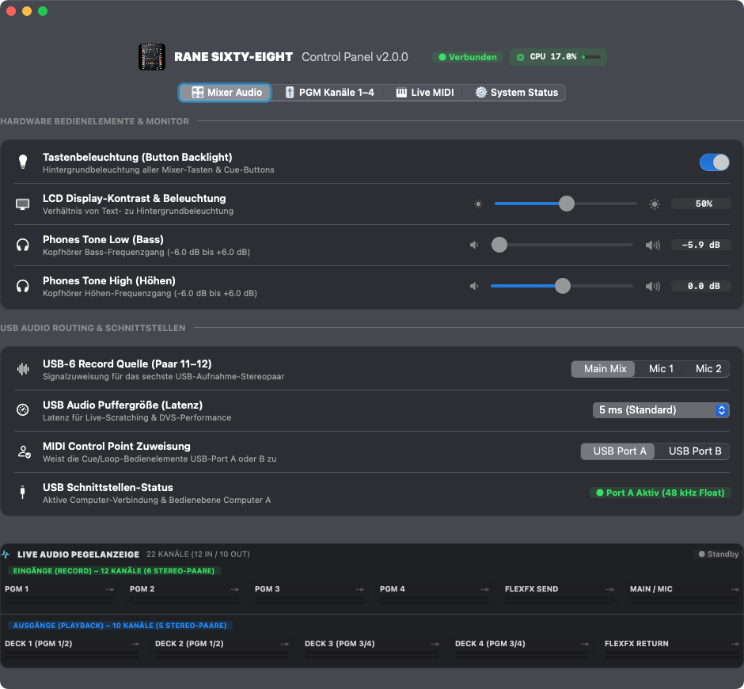
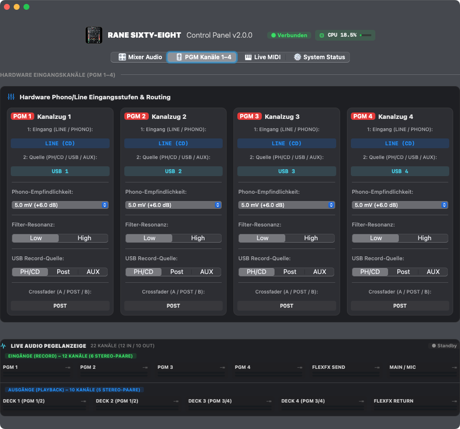
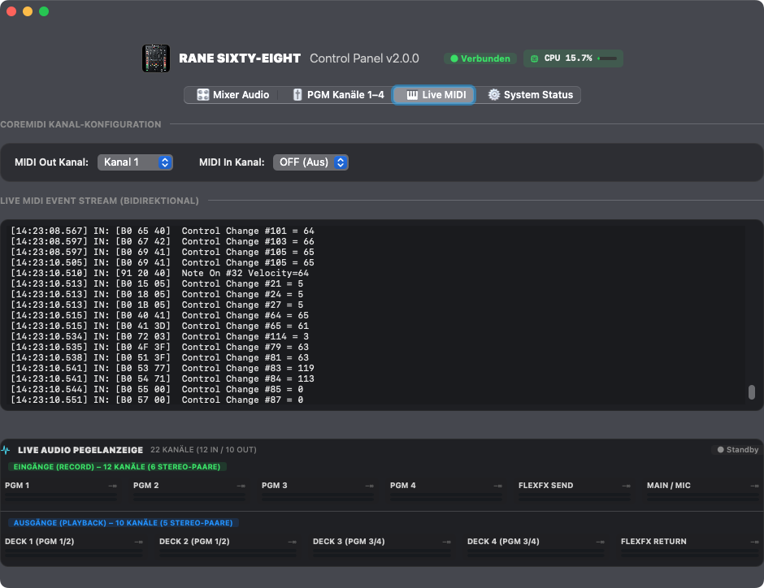
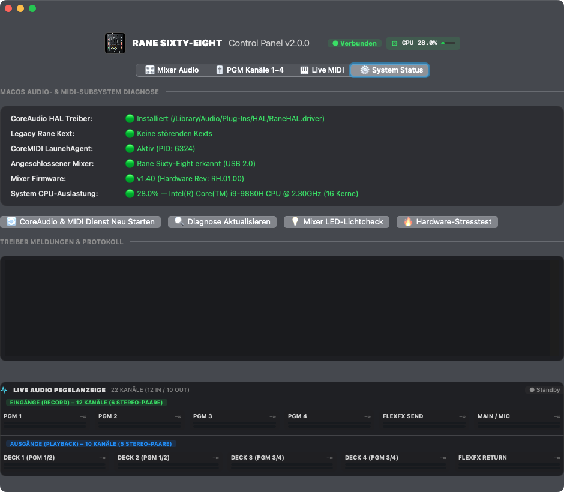
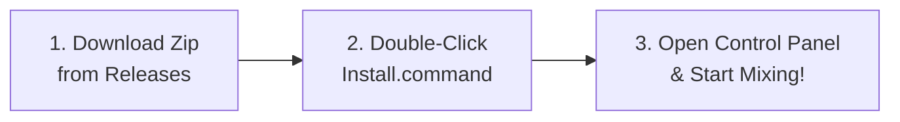
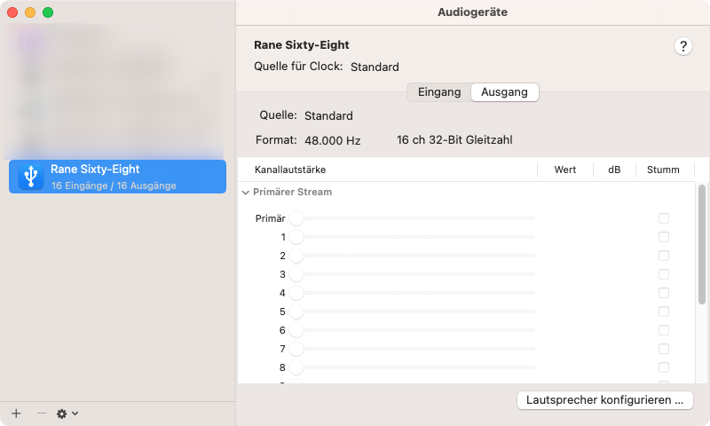

<p align="center">
  
</p>

# 🎧 Rane Sixty-Eight macOS Driver (Apple Silicon M1–M4 & Intel)

[-black.svg?style=flat&logo=apple)](https://github.com/cmdl77/rane-sixty-eight-driver)
[%20%7C%20Intel-blue.svg)](https://github.com/cmdl77/rane-sixty-eight-driver)
[](https://github.com/cmdl77/rane-sixty-eight-driver)
[](LICENSE)
[](https://buymeacoffee.com/cmdl77)

A modern, high-performance, **100% User-Space CoreAudio HAL Driver** and **MIDI LaunchAgent** for the **Rane Sixty-Eight** DJ mixer on modern macOS versions (macOS 11 Big Sur through macOS 15 Sequoia).

> [!NOTE]
> **Zero Kernel Extensions (Kexts) required!** Runs completely in user-space inside macOS `coreaudiod`. No need to disable System Integrity Protection (SIP) or lower system security on Apple Silicon.

---

## 📸 Screenshots

| 🎛 Mixer Audio & Buffer Latency | 🎚 PGM Channels 1–4 Routing |
| :---: | :---: |
|  |  |

| 🎹 Live MIDI Monitor & Channel Setup | ⚙️ System Status & Hardware LED Check |
| :---: | :---: |
|  |  |

---

## 🚀 Easy 3-Step Visual Installation (For DJs)



### Step 1: Download Release
Download the pre-compiled **`Rane-Sixty-Eight-macOS-Driver.zip`** from the [Releases](https://github.com/cmdl77/rane-sixty-eight-driver/releases) section and extract it.

### Step 2: One-Click Installation
Double-click **`Install.command`** in the extracted folder. 
Enter your Mac administrator password when prompted. The installer will:
1. Install the CoreAudio HAL audio plugin to `/Library/Audio/Plug-Ins/HAL/`.
2. Clear macOS quarantine flags (`xattr -cr`) to bypass Gatekeeper warnings.
3. Register the background MIDI daemon and launch the Control Panel.

### Step 3: Verified in macOS Audio MIDI Setup
Your **Rane Sixty-Eight** appears immediately in **Traktor Pro, Serato DJ, Ableton Live**, and macOS **Audio MIDI Setup** with **16 Inputs and 16 Outputs** (48.000 Hz, 32-Bit Floating Point):



---

## 💡 Troubleshooting Gatekeeper on macOS 14 / 15

If macOS shows an alert stating *"Developer cannot be verified"*:
- **macOS Sonoma / Ventura:** Right-click `Rane Sixty-Eight Control Panel.app` → Click **Open** → Confirm **Open**.
- **macOS Sequoia (15):** Open **System Settings** → **Privacy & Security** → Scroll down and click **"Open Anyway"**.

---

## 🛠 Features & Highlights (v2.0.0)

- **22-Kanal Live Audio Pegelanzeige (12 IN / 10 OUT):** Echtzeit VU-Meter für alle 12 Aufnahme-Kanäle (PGM 1–4, FlexFX Send, Main Mix) und 10 Playback-Kanäle (Decks 1–4, FlexFX Return) direkt im Control Panel bei 48 kHz / 32-Bit Float.
- **Vollständige PGM 1–4 Hardware-Synchronisation:**
  - **Feld 1:** Physischer Rückseiten-Schalter (`LINE (CD)` vs. `PHONO` vs. `S/PDIF` – CC 112–115).
  - **Feld 2:** Exakte Drehschalter-Quellenwahl (`PH/CD 1–4`, `USB 1–4`, `AUX 1–4` – CC 116–119).
  - **Feld 3:** Crossfader-Zuweisung (`CROSSFADER A` vs. `POST` vs. `CROSSFADER B` – CC 120–123) im einheitlichen zentrierten Hardware-Badge-Stil.
- **Echtzeit CPU-Auslastungsanzeige:**
  - Kompaktes, farbcodiertes Hardware-Badge mit Micro-Meter-Balken direkt im Header (auf allen Tabs sichtbar, 1-Klick-Sprung zur Systemdiagnose).
  - Detaillierte Systemauslastung mit CPU-Modell- und Kern-Erkennung in Tab 4 (*System Status*).
  - Live CPU-Anzeige im macOS Menüleisten-Widget.
- **Anti-Stutter MIDI-Quittierung & Slider-Drosselung:** Schützt den USB-Bus vor Überlastung beim schnellen Bewegen von Reglern (Phones Tone, LCD-Kontrast).
- **macOS Menüleisten-Widget (Status Item):** Schneller Zugriff auf Puffergröße/Latenz, Verbindungsstatus und Audio MIDI Setup direkt aus der oberen macOS-Menüleiste.
- **Zweisprachig (Deutsch & Englisch):** Vollständige Lokalisierung aller Tabs, Tooltips und Systemmenüs inklusive Versionsanzeige `v2.0.0`.
- **Native Apple Silicon (M1–M4) & Intel:** Kompiliert als Universal 2 Binary für maximale Effizienz und minimale Latenz ohne Rosetta 2.
- **Integrierte Hardware-Diagnose:** LED-Chaser-Lichtcheck und Stresstest direkt im Control Panel.

---

## 🏗 Building from Source

For developers who wish to compile the driver themselves:

```bash
git clone https://github.com/cmdl77/rane-sixty-eight-driver.git
cd rane-sixty-eight-driver
./build.sh
```

Prerequisites: Xcode Command Line Tools (`xcode-select --install`) and CMake (`brew install cmake`).

Detailed pipeline explanations, audio codec formulas, and ring buffer internals can be found in [docs/ARCHITECTURE.md](docs/ARCHITECTURE.md).

---

## 🙏 Acknowledgments & Credits

Special thanks to the open-source audio & DJ community:
- **[mischa85/Ozzy](https://github.com/mischa85/Ozzy)** for pioneering research into macOS user-space audio drivers and USB reverse engineering for vintage DJ gear.
- **[MCDShema/xone](https://github.com/MCDShema/xone)** for architectural inspiration on isochronous audio streaming and HAL buffer scheduling.
- **[Mixxx Project](https://github.com/mixxxdj/mixxx)** for controller protocol research and community DJ mapping knowledge.

---

## ☕ Support the Project

If this driver brought your Rane Sixty-Eight back to life, consider buying a coffee to support continued development and maintenance:

[](https://buymeacoffee.com/cmdl77)

---

## 🤝 Contributing

Contributions, bug reports, and hardware testing on other Rane devices (e.g., Sixty-Four, Sixty-Two, SL4) are warmly welcome! Please feel free to open an Issue or submit a Pull Request.

---

## ⚖️ License & Disclaimer

This project is licensed under the [MIT License](LICENSE).

*Disclaimer: This project is an independent open-source driver developed for hardware interoperability. It is not affiliated with, endorsed by, or sponsored by Rane Corporation or inMusic Brands.*
