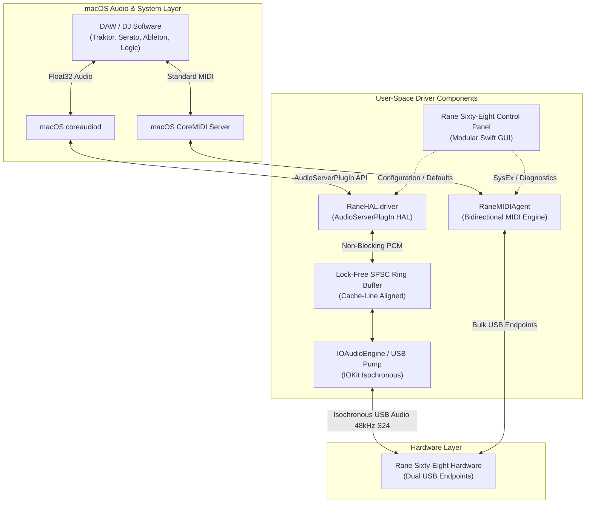

# 🏛 Architecture & Developer Guide

This document explains the internal architecture, protocol design, audio pipeline, and optimization strategies of the **Rane Sixty-Eight macOS User-Space Driver**.

---

## 📐 System Architecture Overview



---

## ⚡ Performance Optimizations

### 1. Vectorized & Branchless Audio Codec (`src/protocol/rane_codec.c`)
The Rane Sixty-Eight transmits and receives audio in 24-bit Signed Little-Endian format (`S24_LE`) packed into 3 bytes or 4-byte words depending on channel interleaving.

- **Inverse Multiplication:** Division is avoided entirely in the audio rendering hot path. We precalculate:
  $$\text{scale} = \frac{1.0}{8388608.0} \approx 1.1920928955 \times 10^{-7}$$
  Replacing division with single-cycle floating-point multiplication (`* kInvS24Scale`).
- **Branchless Sign Extension:**
  ```c
  // Converts 24-bit two's complement to 32-bit signed integer without branching:
  int32_t val = (raw_byte0 | (raw_byte1 << 8) | (raw_byte2 << 16));
  val = (val << 8) >> 8; // Arithmetic shift extends sign bit
  float sample = (float)val * kInvS24Scale;
  ```
- **SIMD / NEON Autovectorization:** Inner loops are structured with contiguous array pointers and strict aliasing guarantees so modern compilers (`clang -O3`) emit vectorized NEON/AVX instructions automatically.

### 2. Lock-Free SPSC Ring Buffer (`src/engine/RaneRing.h`)
Audio between the real-time `coreaudiod` thread and the background IOKit USB pump is buffered using a Single-Producer Single-Consumer lock-free ring buffer:
- **False-Sharing Prevention:** Atomic head and tail pointers are aligned to separate 64-byte hardware cache lines (`alignas(64) std::atomic<size_t> mHead;`).
- **Zero Allocations & Zero Locks:** Never blocks, allocates memory, or acquires mutexes in the CoreAudio real-time deadline thread.

---

## 📦 Modular Swift Control Panel Architecture

The Swift Control Panel application (`src/manager/`) is separated into decoupled modules:

```text
src/manager/
├── App/
│   └── AppDelegate.swift             # App lifecycle, menu bar & window delegation
├── Common/
│   └── Localization.swift            # Clean UI localization strings
├── Controller/
│   ├── MainWindowController.swift    # Core window controller & state coordination
│   ├── MainWindowController+MIDI.swift       # Virtual MIDI endpoint discovery
│   ├── MainWindowController+HardwareTests.swift # LED chaser & hardware stress test
│   └── MainWindowController+Diagnostics.swift  # USB packet log & real-time telemetry
├── Models/
│   └── MixerModels.swift             # PGM channel modes, audio formats & settings
├── Service/
│   └── RaneMidiService.swift         # CoreMIDI client & SysEx / CC dispatch
├── Views/
│   ├── Components/
│   │   └── UIComponents.swift        # Cards, sliders, VU meters, segmented controls
│   └── Tabs/
│       ├── MixerAudioTab.swift       # Tab 1: Latency buffers & output routing
│       ├── PgmChannelsTab.swift      # Tab 2: Channels 1–4 line/phono matrix
│       ├── LiveMidiTab.swift         # Tab 3: MIDI monitor & channel mappings
│       └── SystemStatusTab.swift     # Tab 4: Diagnostics, USB health & LED tests
└── main.swift                        # Clean 10-line application entrypoint
```

---

## 🛠 Hardware Verification & Stress Testing

Two standalone diagnostic command-line tools are compiled alongside the driver:
1. **`rane-selftest`**: Verifies USB descriptor detection, endpoint availability, and loopback latency.
2. **`rane-stresstest`**: Stresses the USB pipeline with maxed buffer throughput across all 16 In and 16 Out channels for 60+ seconds, reporting packet jitter and zero-loss guarantees.

Run tests directly:
```bash
./build/rane-selftest
./build/rane-stresstest --duration 30
```
