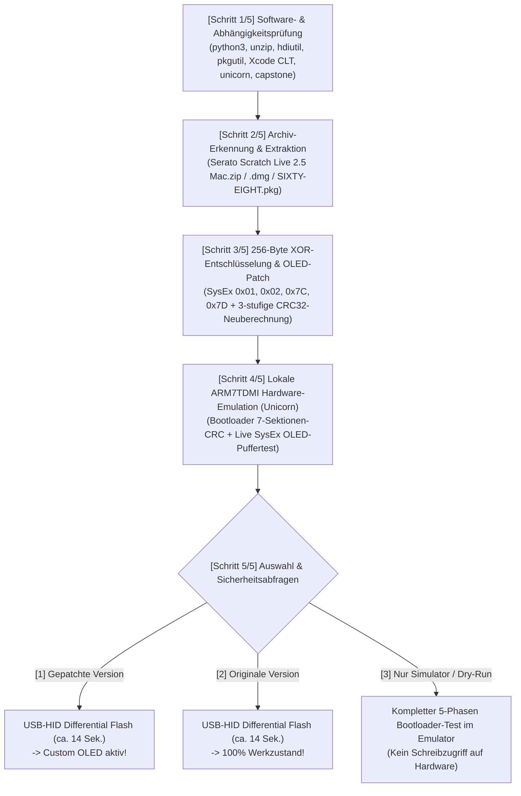

# 📺 Rane Sixty-Eight Firmware Extractor, Custom-OLED Patcher & USB Flasher

Diese Dokumentation beschreibt das automatische Extrahieren, Entschlüsseln, Patchen, Emulieren und Flashen der **Rane Sixty-Eight** Hardware-Firmware unter macOS (Apple Silicon M1–M4 & Intel).

---

## 1. Offizielle Firmware-Quelle (Serato Scratch Live 2.5 Download)

Aus lizenzrechtlichen Gründen wird die proprietäre Original-Firmware von Rane/Serato nicht direkt als Binärdatei benötigt, sondern kann vom Skript **vollautomatisch aus dem offiziellen Serato-Installer extrahiert** werden:

1. Öffne die offizielle Download-Seite für die letzte Version von **Serato Scratch Live 2.5 (Mac)**:
   👉 **[https://serato.com/scratchlive/downloads](https://serato.com/scratchlive/downloads)**
   *(Hinweis: Zum kostenlosen Download wird ein Serato-Account benötigt).*
2. Lade die Datei **`Serato Scratch Live 2.5 Mac.zip`** herunter und belasse sie einfach in deinem `~/Downloads`-Ordner (oder lege sie in das Projektverzeichnis).
3. *Alternativ:* Das Skript unterstützt ebenso das eigenständige Rane-Treiberpaket **`SIXTY-EIGHT.pkg`** (aus `SIXTY-EIGHT 1.2.0` bzw. `SIXTY-EIGHT 2.0.0b3`), welches die neuere Firmware **`v1.28` (`0x0128` / Dezimal `1.40`)** enthält, während `Serato Scratch Live 2.5 Mac.zip` (`Sixty-Eight 1.1.2f5.pkg`) die Firmware **`v1.1E` (`0x011E` / Dezimal `1.30`)** enthält. Beide Versionen werden zu 100 % unterstützt!

---

## 2. Schnellstart: Interaktiver Assistent (`./patch_and_flash_firmware.sh`)

Starte im Projektverzeichnis einfach das Skript:

```bash
./patch_and_flash_firmware.sh
```

### Was das Skript Schritt für Schritt ausführt:



---

## 3. Automatische Software-Prüfung & Sicherheitsabfragen

### Geprüfte System-Tools & Bibliotheken (`[SCHRITT 1/5]`)
Vor dem Start prüft [`tools/rane_firmware_patcher_and_flasher.py`](../tools/rane_firmware_patcher_and_flasher.py) automatisch alle Voraussetzungen und installiert fehlende Pakete nach Rückfrage nach:

| Komponente | Zweck | Automatische Installation |
| :--- | :--- | :--- |
| **`xcode-select`** | macOS Command Line Tools | `xcode-select --install` (nach Rückfrage) |
| **`unzip` / `hdiutil` / `pkgutil`** | Entpacken von `.zip`, Mounten der `.dmg` (inkl. SLA) & Extrahieren von `.pkg` | Systembestandteil / `brew install` |
| **`unicorn` (Python)** | Emuliert den echten LPC2468 ARM7TDMI Bootloader & prüft alle 7 Sektions-CRCs vor dem Flash | `pip3 install unicorn` (nach Rückfrage) |
| **`capstone` (Python)** | ARM7TDMI Disassembler zur Instruktionsprüfung | `pip3 install capstone` (nach Rückfrage) |

### Mehrstufige Sicherheitsabfragen (`Sicherheitsabfragen`)
Damit ein versehentliches oder fehlerhaftes Flashen ausgeschlossen ist, besitzt das Skript **5 unabhängige Sicherheitsstufen**:
1. **Instruktions-Verifikation vor dem Patch:** Vor dem Ändern eines einzigen Bytes prüft das Skript, ob an den Zieladressen in `Section 2` (`0x08000`) exakt die erwarteten Original-ARM7TDMI-Befehle stehen.
2. **Dreistufige CRC32-Validierung (`validate_firmware_image`):** Jedes erzeugte Image wird gegen Ranes offizielle `IsValidFirmwareImage`-Routine geprüft (Header-Magic, `VID:PID 0x1CC5:0x0004`, Big-Endian Payload-CRC32 an `0x003C` sowie alle 7 bit-invertierten Sektions-CRCs).
3. **Echter ARM7TDMI Bootloader-Test im Unicorn-Emulator:** Das gepatchte Image wird im lokalen ARM-Emulator durch die originale Bootloader-Prüfroutine (`0x02404` bzw. `0x0241C`) geschickt. Nur wenn der emulierte Bootloader `R0 = 1 (VALID)` zurückgibt und der simulierte `SysEx 0x7D / 0x01 / 0x02 / 0x7C`-Test erfolgreich durchläuft, wird das Image zum Flashen freigegeben.
4. **Prozess-Konfliktprüfung (`check_conflicting_processes`):** Laufende Programme (`Rane Driver Manager`, `RaneMIDIAgent`, `Scratch LIVE`, `Serato DJ`), die den USB-HID-Kanal belegen könnten, werden erkannt und nach Rückfrage vor dem Flash sauber beendet.
5. **Zweistufige Hardware-Bestätigung:** Vor dem eigentlichen Schreibvorgang fragt das Skript explizit ab, ob Strom- und USB-Verbindung stabil sind (`[j/N]`), und verlangt anschließend die manuelle Eingabe des Wortes **`FLASH`**.

---

## 4. Kommandozeilen-Optionen (CLI)

Neben dem interaktiven Menü kann [`patch_and_flash_firmware.sh`](../patch_and_flash_firmware.sh) auch direkt über Parameter gesteuert werden:

```bash
# Interaktiver Assistent (sucht automatisch nach Serato Scratch Live 2.5 Mac.zip in ~/Downloads)
./patch_and_flash_firmware.sh

# Nur Extrahieren, Patchen & im Unicorn-Emulator verifizieren (ohne Hardware-Flash)
./patch_and_flash_firmware.sh --input ~/Downloads/"Serato Scratch Live 2.5 Mac.zip" --mode extract-only

# Gezielt aus einem Rane SIXTY-EIGHT.pkg extrahieren & interaktiv wählen
./patch_and_flash_firmware.sh --input ~/Downloads/SIXTY-EIGHT-2.0.0b3/SIXTY-EIGHT.pkg
```

Die extrahierten und gepatchten Firmware-Images werden übersichtlich im Ordner `firmware_extracted/` abgelegt:
- `sixty_eight_firmware_v1_1E_original.bin` & `sixty_eight_firmware_v1_1E_oled_patched.bin` (aus Serato Scratch Live 2.5)
- `sixty_eight_firmware_v1_28_original.bin` & `sixty_eight_firmware_v1_28_oled_patched.bin` (aus Rane SIXTY-EIGHT.pkg)

---

## 5. Technische Details: Wie der Custom-OLED-Patch funktioniert

### 5.1 Entschlüsselung aus `SIXTY-EIGHTApi`
Innerhalb des Rane-Treiberpakets (`Sixty-Eight 1.1.2f5.pkg` bzw. `SIXTY-EIGHT.pkg`) befindet sich die Mach-O-Bibliothek `SIXTY-EIGHTApi.framework/Versions/A/SIXTY-EIGHTApi`. Darin ist das Firmware-Image mit einem 256-Byte-XOR-Schlüssel (`kkey`, SHA-256 `d47954d8...370dc60`) verschlüsselt eingebettet:
$$\text{plain}[i] = \text{cipher}[i] \oplus \text{kkey}[i \bmod 256]$$

### 5.2 Freischaltung des Hardware-OLED-Displays (`Section 2` / LPC2468 ARM7TDMI)
In der Werks-Firmware existieren im USB-MIDI-SysEx-Parser (`F0 17 <cmd> ... F7`) bereits die Handler für:
- **`0x01`** (14 ASCII-Zeichen für Zeile 1)
- **`0x02`** (14 ASCII-Zeichen für Zeile 2)
- **`0x7D`** (setzt das Flag `[0x4000013B] = 1` und ruft `update_lcd()` auf)
- **`0x7C`** (setzt das Flag `[0x4000013B] = 0` und ruft `update_lcd()` auf)

Allerdings schrieb Rane in der Werks-Firmware bei `0x01`/`0x02` in zwei ungenutzte Schattenpuffer (`0x4000011F` / `0x4000012D`) und überschrieb im anschließenden `update_lcd()`-Aufruf sofort wieder beide Zeilen mit `BPM:` und `TIME:`.

Unser **minimal-invasiver 8-Wort-Patch** in `Section 2` behebt genau das:
1. **Aktive OLED-Zeilenpuffer verknüpfen:**
   - Literal-Pool-Zeiger für `SysEx 0x01` (`0x0C808` in `v1.28` / `0x0C914` in `v1.1E`): `0x4000011F` $\rightarrow$ **`0x400000E7`** (aktiver OLED-Zeile-1-Puffer).
   - Literal-Pool-Zeiger für `SysEx 0x02` (`0x0C80C` in `v1.28` / `0x0C918` in `v1.1E`): `0x4000012D` $\rightarrow$ **`0x400000F5`** (aktiver OLED-Zeile-2-Puffer).
2. **SPI-OLED-Dirty-Flags setzen statt `update_lcd()` aufzurufen:**
   - In `SysEx 0x01` (`0x0BBC8` in `v1.28` / `0x0BC14` in `v1.1E`): Setzt `[0x40000176] = 0x11` (weist die Hauptschleife an, Zeile 1 per SPI an das OLED zu übertragen).
   - In `SysEx 0x02` (`0x0BC24` in `v1.28` / `0x0BC70` in `v1.1E`): Setzt `[0x40000177] = 0x11` (weist die Hauptschleife an, Zeile 2 per SPI an das OLED zu übertragen).
3. **`update_lcd()` respektiert das Custom-Mode-Flag `[0x4000013B]`:**
   - Am Anfang von `update_lcd()` (`0x08A44..0x08A60` in `v1.28` / `0x08A40..0x08A4C` in `v1.1E`) wird geprüft, ob `[0x4000013B] != 0` (`SysEx 0x7D` aktiv) ist. Falls ja, kehrt `update_lcd()` sofort zurück, sodass Hintergrund-BPM-Updates den eigenen Text nicht überschreiben. Sobald `SysEx 0x7C` (`F0 17 7C 00 F7`) gesendet wird, ist `[0x4000013B] == 0` und `update_lcd()` stellt sofort das originale `BPM:` / `TIME:`-Display wieder her.

### 5.3 Custom-OLED SysEx-Protokoll im Überblick (für eigene Skripte & Control Panel)

| Funktion | SysEx-Bytes (Hex) | Beschreibung |
| :--- | :--- | :--- |
| **Custom-OLED-Modus EIN** | `F0 17 7D 01 F7` | Sperrt `update_lcd()`, damit eigener Text auf dem Display stehen bleibt |
| **Zeile 1 schreiben (14 Z.)** | `F0 17 01 <14 ASCII-Bytes> F7` | Schreibt 14 ASCII-Zeichen direkt in Zeile 1 des OLED-Displays |
| **Zeile 2 schreiben (14 Z.)** | `F0 17 02 <14 ASCII-Bytes> F7` | Schreibt 14 ASCII-Zeichen direkt in Zeile 2 des OLED-Displays |
| **Custom-OLED-Modus AUS** | `F0 17 7C 00 F7` | Schaltet sofort zurück auf die originale `BPM:` / `TIME:`-Anzeige |

---

## 6. Features in der Control Panel App (`Rane Driver Manager.app`)

Mit installierter Custom-OLED-Firmware unterstützt die macOS Control Panel App automatisch:
1. **5 Sekunden Begrüßungstext beim App-Start & Preset-Wechsel:**
   - Frei editierbar im Tab **System Status** (*Zeile 1* & *Zeile 2*, je max. 14 Zeichen) inkl. Live-Test-Button **„📺 Speichern & 5s am Mixer zeigen“**.
   - Wird automatisch in jedem **Mixer-Preset** (`RaneMixerPreset`) mitgespeichert und beim Laden eines Presets für 5 Sekunden auf dem Hardware-Display eingeblendet, bevor das Display wieder auf das originale `BPM:` / `TIME:` zurückspringt.
2. **2 Sekunden Ableton Link Status-Einblendung:**
   - Beim Aktivieren oder Deaktivieren von **Ableton Link** zeigt Zeile 2 des Hardware-OLEDs für **2 Sekunden** `"AbletonLink on"` bzw. `"AbletonLinkoff"` an und wechselt danach automatisch wieder zur regulären `BPM:` / `TIME:`-Anzeige.
