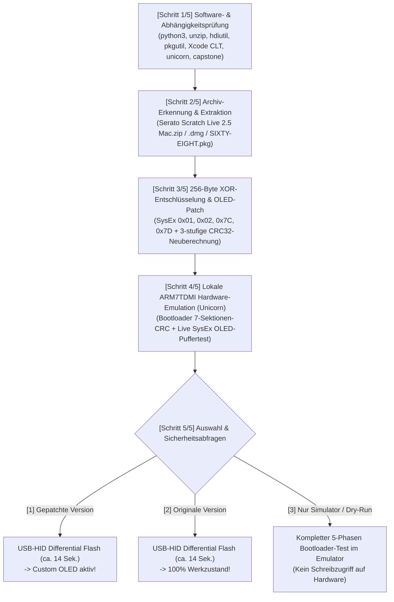

# 📺 Rane Sixty-Eight Firmware Extractor, Custom-OLED Patcher & USB Flasher

Diese Dokumentation beschreibt das automatische Extrahieren, Entschlüsseln, Patchen, Emulieren und Flashen der **Rane Sixty-Eight** Hardware-Firmware unter macOS (Apple Silicon M1–M4 & Intel).

---

## 1. Offizielle Firmware-Quelle (Serato Scratch Live 2.5 Download)

Aus lizenzrechtlichen Gründen wird die proprietäre Original-Firmware von Rane/Serato nicht direkt als Binärdatei benötigt, sondern kann vom Skript **vollautomatisch aus dem offiziellen Serato-Installer extrahiert** werden:

1. Öffne die offizielle Download-Seite für die letzte Version von **Serato Scratch Live 2.5 (Mac)**:
   👉 **[https://serato.com/scratchlive/downloads](https://serato.com/scratchlive/downloads)**
   *(Hinweis: Zum kostenlosen Download wird ein Serato-Account benötigt).*
2. Lade die Datei **`Serato Scratch Live 2.5 Mac.zip`** herunter und belasse sie einfach in deinem `~/Downloads`-Ordner (oder lege sie in das Projektverzeichnis).
3. *Alternativ:* Das Skript unterstützt ebenso das eigenständige Rane-Treiberpaket **`SIXTY-EIGHT.pkg`** (aus `SIXTY-EIGHT 1.2.0` bzw. `SIXTY-EIGHT 2.0.0b3`), welches die neuere Firmware **`v1.28` (`0x0128` / Dezimal `1.40`)** enthält, während `Serato Scratch Live 2.5 Mac.zip` (`Sixty-Eight 1.1.2f5.pkg`) die Firmware **`v1.1E` (`0x011E` / Dezimal `1.30`)** enthält. Beide Versionen werden zu 100 % unterstützt!

---

## 2. Schnellstart: Interaktiver Assistent (`./patch_and_flash_firmware.sh`)

Starte im Projektverzeichnis einfach das Skript:

```bash
./patch_and_flash_firmware.sh
```

### Was das Skript Schritt für Schritt ausführt:



---

## 3. Automatische Software-Prüfung & Sicherheitsabfragen

### Geprüfte System-Tools & Bibliotheken (`[SCHRITT 1/5]`)
Vor dem Start prüft [`tools/rane_firmware_patcher_and_flasher.py`](../tools/rane_firmware_patcher_and_flasher.py) automatisch alle Voraussetzungen und installiert fehlende Pakete nach Rückfrage nach:

| Komponente | Zweck | Automatische Installation |
| :--- | :--- | :--- |
| **`xcode-select`** | macOS Command Line Tools | `xcode-select --install` (nach Rückfrage) |
| **`unzip` / `hdiutil` / `pkgutil`** | Entpacken von `.zip`, Mounten der `.dmg` (inkl. SLA) & Extrahieren von `.pkg` | Systembestandteil / `brew install` |
| **`unicorn` (Python)** | Emuliert den echten LPC2468 ARM7TDMI Bootloader & prüft alle 7 Sektions-CRCs vor dem Flash | `pip3 install unicorn` (nach Rückfrage) |
| **`capstone` (Python)** | ARM7TDMI Disassembler zur Instruktionsprüfung | `pip3 install capstone` (nach Rückfrage) |

### Mehrstufige Sicherheitsabfragen (`Sicherheitsabfragen`)
Damit ein versehentliches oder fehlerhaftes Flashen ausgeschlossen ist, besitzt das Skript **5 unabhängige Sicherheitsstufen**:
1. **Instruktions-Verifikation vor dem Patch:** Vor dem Ändern eines einzigen Bytes prüft das Skript, ob an den Zieladressen in `Section 2` (`0x08000`) exakt die erwarteten Original-ARM7TDMI-Befehle stehen.
2. **Dreistufige CRC32-Validierung (`validate_firmware_image`):** Jedes erzeugte Image wird gegen Ranes offizielle `IsValidFirmwareImage`-Routine geprüft (Header-Magic, `VID:PID 0x1CC5:0x0004`, Big-Endian Payload-CRC32 an `0x003C` sowie alle 7 bit-invertierten Sektions-CRCs).
3. **Echter ARM7TDMI Bootloader-Test im Unicorn-Emulator:** Das gepatchte Image wird im lokalen ARM-Emulator durch die originale Bootloader-Prüfroutine (`0x02404` bzw. `0x0241C`) geschickt. Nur wenn der emulierte Bootloader `R0 = 1 (VALID)` zurückgibt und der simulierte `SysEx 0x7D / 0x01 / 0x02 / 0x7C`-Test erfolgreich durchläuft, wird das Image zum Flashen freigegeben.
4. **Prozess-Konfliktprüfung (`check_conflicting_processes`):** Laufende Programme (`Rane Driver Manager`, `RaneMIDIAgent`, `Scratch LIVE`, `Serato DJ`), die den USB-HID-Kanal belegen könnten, werden erkannt und nach Rückfrage vor dem Flash sauber beendet.
5. **Zweistufige Hardware-Bestätigung:** Vor dem eigentlichen Schreibvorgang fragt das Skript explizit ab, ob Strom- und USB-Verbindung stabil sind (`[j/N]`), und verlangt anschließend die manuelle Eingabe des Wortes **`FLASH`**.

---

## 4. Kommandozeilen-Optionen (CLI)

Neben dem interaktiven Menü kann [`patch_and_flash_firmware.sh`](../patch_and_flash_firmware.sh) auch direkt über Parameter gesteuert werden:

```bash
# Interaktiver Assistent (sucht automatisch nach Serato Scratch Live 2.5 Mac.zip in ~/Downloads)
./patch_and_flash_firmware.sh

# Nur Extrahieren, Patchen & im Unicorn-Emulator verifizieren (ohne Hardware-Flash)
./patch_and_flash_firmware.sh --input ~/Downloads/"Serato Scratch Live 2.5 Mac.zip" --mode extract-only

# Gezielt aus einem Rane SIXTY-EIGHT.pkg extrahieren & interaktiv wählen
./patch_and_flash_firmware.sh --input ~/Downloads/SIXTY-EIGHT-2.0.0b3/SIXTY-EIGHT.pkg
```

Die extrahierten und gepatchten Firmware-Images werden übersichtlich im Ordner `firmware_extracted/` abgelegt:
- `sixty_eight_firmware_v1_1E_original.bin` & `sixty_eight_firmware_v1_1E_oled_patched.bin` (aus Serato Scratch Live 2.5)
- `sixty_eight_firmware_v1_28_original.bin` & `sixty_eight_firmware_v1_28_oled_patched.bin` (aus Rane SIXTY-EIGHT.pkg)

---

## 5. Technische Details: Wie der Custom-OLED-Patch funktioniert

### 5.1 Entschlüsselung aus `SIXTY-EIGHTApi`
Innerhalb des Rane-Treiberpakets (`Sixty-Eight 1.1.2f5.pkg` bzw. `SIXTY-EIGHT.pkg`) befindet sich die Mach-O-Bibliothek `SIXTY-EIGHTApi.framework/Versions/A/SIXTY-EIGHTApi`. Darin ist das Firmware-Image mit einem 256-Byte-XOR-Schlüssel (`kkey`, SHA-256 `d47954d8...370dc60`) verschlüsselt eingebettet:
$$\text{plain}[i] = \text{cipher}[i] \oplus \text{kkey}[i \bmod 256]$$

### 5.2 Freischaltung des Hardware-OLED-Displays (`Section 2` / LPC2468 ARM7TDMI)
In der Werks-Firmware existieren im USB-MIDI-SysEx-Parser (`F0 17 <cmd> ... F7`) bereits die Handler für:
- **`0x01`** (14 ASCII-Zeichen für Zeile 1)
- **`0x02`** (14 ASCII-Zeichen für Zeile 2)
- **`0x7D`** (setzt das Flag `[0x4000013B] = 1` und ruft `update_lcd()` auf)
- **`0x7C`** (setzt das Flag `[0x4000013B] = 0` und ruft `update_lcd()` auf)

Allerdings schrieb Rane in der Werks-Firmware bei `0x01`/`0x02` in zwei ungenutzte Schattenpuffer (`0x4000011F` / `0x4000012D`) und überschrieb im anschließenden `update_lcd()`-Aufruf sofort wieder beide Zeilen mit `BPM:` und `TIME:`.

Unser **minimal-invasiver 8-Wort-Patch** in `Section 2` behebt genau das:
1. **Aktive OLED-Zeilenpuffer verknüpfen:**
   - Literal-Pool-Zeiger für `SysEx 0x01` (`0x0C808` in `v1.28` / `0x0C914` in `v1.1E`): `0x4000011F` $\rightarrow$ **`0x400000E7`** (aktiver OLED-Zeile-1-Puffer).
   - Literal-Pool-Zeiger für `SysEx 0x02` (`0x0C80C` in `v1.28` / `0x0C918` in `v1.1E`): `0x4000012D` $\rightarrow$ **`0x400000F5`** (aktiver OLED-Zeile-2-Puffer).
2. **SPI-OLED-Dirty-Flags setzen statt `update_lcd()` aufzurufen:**
   - In `SysEx 0x01` (`0x0BBC8` in `v1.28` / `0x0BC14` in `v1.1E`): Setzt `[0x40000176] = 0x11` (weist die Hauptschleife an, Zeile 1 per SPI an das OLED zu übertragen).
   - In `SysEx 0x02` (`0x0BC24` in `v1.28` / `0x0BC70` in `v1.1E`): Setzt `[0x40000177] = 0x11` (weist die Hauptschleife an, Zeile 2 per SPI an das OLED zu übertragen).
3. **`update_lcd()` respektiert das Custom-Mode-Flag `[0x4000013B]`:**
   - Am Anfang von `update_lcd()` (`0x08A44..0x08A60` in `v1.28` / `0x08A40..0x08A4C` in `v1.1E`) wird geprüft, ob `[0x4000013B] != 0` (`SysEx 0x7D` aktiv) ist. Falls ja, kehrt `update_lcd()` sofort zurück, sodass Hintergrund-BPM-Updates den eigenen Text nicht überschreiben. Sobald `SysEx 0x7C` (`F0 17 7C 00 F7`) gesendet wird, ist `[0x4000013B] == 0` und `update_lcd()` stellt sofort das originale `BPM:` / `TIME:`-Display wieder her.

### 5.3 Custom-OLED SysEx-Protokoll im Überblick (für eigene Skripte & Control Panel)

| Funktion | SysEx-Bytes (Hex) | Beschreibung |
| :--- | :--- | :--- |
| **Custom-OLED-Modus EIN** | `F0 17 7D 01 F7` | Sperrt `update_lcd()`, damit eigener Text auf dem Display stehen bleibt |
| **Zeile 1 schreiben (14 Z.)** | `F0 17 01 <14 ASCII-Bytes> F7` | Schreibt 14 ASCII-Zeichen direkt in Zeile 1 des OLED-Displays |
| **Zeile 2 schreiben (14 Z.)** | `F0 17 02 <14 ASCII-Bytes> F7` | Schreibt 14 ASCII-Zeichen direkt in Zeile 2 des OLED-Displays |
| **Custom-OLED-Modus AUS** | `F0 17 7C 00 F7` | Schaltet sofort zurück auf die originale `BPM:` / `TIME:`-Anzeige |

---

## 6. Features in der Control Panel App (`Rane Driver Manager.app`)

Mit installierter Custom-OLED-Firmware unterstützt die macOS Control Panel App automatisch:
1. **5 Sekunden Begrüßungstext beim App-Start & Preset-Wechsel:**
   - Frei editierbar im Tab **System Status** (*Zeile 1* & *Zeile 2*, exakt 14 Monospace-Zeichen) inkl. Live-Test-Button **„📺 Speichern & 5s am Mixer zeigen“**.
   - Wird automatisch in jedem **Mixer-Preset** (`RaneMixerPreset`) mitgespeichert und beim Laden eines Presets für 5 Sekunden auf dem Hardware-Display eingeblendet, bevor das Display wieder auf das originale `BPM:` / `TIME:` zurückspringt.
2. **2 Sekunden Ableton Link Status-Einblendung:**
   - Beim Aktivieren oder Deaktivieren von **Ableton Link** zeigt Zeile 2 des Hardware-OLEDs für **2 Sekunden** `"AbletonLink on"` bzw. `"AbletonLinkoff"` an und wechselt danach automatisch wieder zur regulären `BPM:` / `TIME:`-Anzeige.

---

## 7. Komplette Firmware-Anatomie & Reverse-Engineering-Referenz

### 7.1 Multi-Chip-Hardware-Architektur im Rane Sixty-Eight
Der Rane Sixty-Eight besteht intern aus einem Verbund von **vier Prozessoren/Logikbausteinen**, die alle über das Firmware-Image versorgt werden:

1. **Hauptprozessor (MCU): NXP LPC2468 (32-Bit ARM7TDMI-S)**
   - Besitzt **512 KB internen Flash-Speicher** (`0x00000000..0x0007FFFF`) und **64 KB SRAM** (`0x40000000..0x4000FFFF`).
   - Besitzt im ROM an Adresse **`0x7FFFFFF0`** das **NXP IAP-Interface (In-Application Programming)**, über das der Bootloader zur Laufzeit Flash-Sektoren löschen (Cmd `52`), prüfen (Cmd `53`), vorbereiten (Cmd `50`) und in 256-Byte-Seiten beschreiben (Cmd `51`) kann.
   - Steuert alle Fader, Potis, Taster, LEDs, das **OLED-Display**, den internen MIDI-Stack und das Routing.
2. **2× USB-2.0-Controller: Cypress EZ-USB FX2LP (8051-CPU)**
   - Je ein Chip für **USB Port A** und **USB Port B**.
   - Besitzen keinen eigenen Flash-Speicher: Beim Einschalten lädt der LPC2468 die 8051-Firmware aus **Section 6** (`0x0007A000`) in das RAM der beiden Cypress-Chips.
   - Kommunizieren mit dem LPC2468 über einen schnellen **SPI-Bus** in 64-Byte-Paketen.
3. **Audio-DSP & FPGA**
   - Verarbeiten die 22 Audio-Kanäle (48 kHz, 32-Bit Float intern) sowie die 6 Hardware-FlexFX-Algorithmen (*Echo, Auto Pan, Flanger, Phaser, Reverb, Robot*).
   - Ihr Programmcode und FPGA-Bitstream werden beim Booten vom LPC2468 aus **Section 3, 4 und 5** geladen.
4. **OLED-Display (2 Zeilen × 14 Zeichen)**
   - Hängt am SPI-Bus des LPC2468 und wird über die Treiberfunktion an Adresse **`0x088F0`** (`v1.28`) bzw. **`0x084FC`** (`v1.1E`) zeilenweise beschrieben.

---

### 7.2 Aufbau der Firmware-Datei & die 7 Flash-Sektionen
Jede entschlüsselte Firmware-Datei beginnt mit einem **64-Byte-Header (`0x0000..0x003F`)**:
- `0x0000..0x001F`: ASCII-Signatur `"Copyright 2009 Rane Corporation\0"`
- `0x0021..0x0024`: USB Vendor-ID **`0x1CC5`** (Rane) & Product-ID **`0x0004`** (Sixty-Eight)
- `0x0027..0x0028`: Firmware-Version (`01 28` für `v1.28` / Dezimal `1.40`, bzw. `01 1E` für `v1.1E` / Dezimal `1.30`)
- `0x0038..0x003B`: Big-Endian Payload-Länge (`0x0003D200` = 250.368 Bytes bei `v1.28`, `0x0003CB00` = 248.576 Bytes bei `v1.1E`)
- `0x003C..0x003F`: Big-Endian Standard-CRC32 über den gesamten Payload ab `0x0040`

Direkt ab Datei-Offset `0x0040` folgen die **7 Flash-Sektionen**, die 1:1 in den Flash des NXP LPC2468 geschrieben werden:

| Sektion | Flash-Adresse (LPC2468) | Datei-Offset (`v1.28`) | Größe (`v1.28`) | Inhalt & Aufgabe |
| :---: | :---: | :---: | :---: | :--- |
| **Bootloader** | `0x00001000` | `0x00140` (Spiegel) | `12.288 B` (`0x03000`) | **Permanenter ARM7-Bootloader:** Prüft beim Einschalten alle 7 Sektionen per Hardware-CRC32 und übernimmt das USB-Recovery-Flashen (`bcdDevice 0x9900`). |
| **Section 0** | `0x00004000` | `0x00040` | `256 B` (`0x00100`) | **Section Summary Table:** Enthält Startadresse, Länge und bit-invertierte CRC32 aller 7 Sektionen. Wird beim Flashen **immer als allerletztes** geschrieben! |
| **Section 1** | `0x00005000` | `0x00140` | `12.288 B` (`0x03000`) | **Bootloader-Kopie** im Flash. |
| **Section 2** | `0x00008000` | `0x03140` | `70.144 B` (`0x11200`) | **ARM7TDMI Main Application (Haupt-Firmware):** Kompiliert mit ARM Keil RVCT. Enthält den gesamten Mixer-Code, die OLED-Logik (`update_lcd`), den MIDI-SysEx-Parser und die USB-EP1-Kommandos. |
| **Section 3** | `0x00038000` | `0x14340` | `67.328 B` (`0x10700`) | **FPGA-Bitstream / Audio-Routing-Logik.** |
| **Section 4** | `0x00060000` | `0x24A40` | `20.480 B` (`0x05000`) | **DSP-Effekt-Parameter & Filter-Tabellen** (FlexFX Algorithmen). |
| **Section 5** | `0x00068000` | `0x29A40` | `72.704 B` (`0x11C00`) | **Haupt-DSP-Audio-Programmcode** (32-Bit Float Mixing & Effekte). |
| **Section 6** | `0x0007A000` | `0x3B640` | `7.168 B` (`0x01C00`) | **Cypress EZ-USB FX2 (8051) USB-Firmware** für USB Port A & B (inkl. Notfall-Bootloader-Image). |

#### Ranes Sektions-Prüfsummen-Algorithmus (`rane_section_crc`)
Während der Datei-Header an `0x003C` eine reguläre IEEE-802.3 CRC32 verwendet, berechnet der ARM7-Bootloader (`0x02404` in `v1.28` / `0x0241C` in `v1.1E`) für die 7 Sektionen in Section 0 eine **bit-gespiegelte invertierte CRC32**:
$$\text{RaneCRC}(D) = \text{BitReverse}_{32}\big(\sim\text{CRC32}(D)\big)$$
Stimmt auch nur ein einziges Bit in einer der 7 Sektionen nicht mit dieser Prüfsumme überein, verweigert der Bootloader den Start der Haupt-Firmware und bleibt im **Bootloader-Recovery-Modus (`bcdDevice = 0x9900`)**.

---

### 7.3 Das SRAM-Speicherlayout (`0x40000000`) zur Laufzeit
Wenn Section 2 (`0x08000`) startet, entpackt der Keil-Startcode (`__scatterload` ab `0x080B0` & `__decompress` ab `0x080F4`) die initialisierten Variablen in das 64 KB große SRAM ab `0x40000000`:

| SRAM-Adresse | Größe | Bedeutung in der Firmware |
| :--- | :---: | :--- |
| **`0x400000E7`** | 14 Bytes | **Aktiver OLED-Textpuffer Zeile 1** (Standard nach Boot: `"BPM:120 *  4/1"`) |
| **`0x400000F5`** | 14 Bytes | **Aktiver OLED-Textpuffer Zeile 2** (Standard nach Boot: `"TIME:  500ms  "`) |
| **`0x4000011F`** | 14 Bytes | Ungenutzter Schattenpuffer 1 (hierhin schrieb `SysEx 0x01` im Werkszustand) |
| **`0x4000012D`** | 14 Bytes | Ungenutzter Schattenpuffer 2 (hierhin schrieb `SysEx 0x02` im Werkszustand) |
| **`0x4000013B`** | 1 Byte | **OLED-Mode-Flag:** `0` = Normal (`BPM:`/`TIME:`), `1` = Custom-Modus (`SysEx 0x7D` aktiv) |
| **`0x40000140`** | 4 Bytes | Aktuelle BPM als IEEE-754 `float` (Standard: `120.0f`) |
| **`0x40000144`** | 1 Byte | Aktiver interner FlexFX-Effekt-Index (`0..5`: Echo, AutoPan, Flanger, Phaser, Reverb, Robot) |
| **`0x40000176`** | 1 Byte | **OLED Zeile 1 Dirty-Counter:** Wird auf `0x11` (17) gesetzt, damit die Hauptschleife Zeile 1 per SPI ans Display schickt |
| **`0x40000177`** | 1 Byte | **OLED Zeile 2 Dirty-Counter:** Wird auf `0x11` (17) gesetzt, damit die Hauptschleife Zeile 2 per SPI ans Display schickt |
| **`0x400001D4`** | 1 Byte | Schreibzeiger (`write_idx`) des 256-Byte USB-MIDI-SysEx-Ringpuffers |
| **`0x400001D5`** | 1 Byte | Lesezeiger (`read_idx`) des 256-Byte USB-MIDI-SysEx-Ringpuffers |
| **`0x400010F6`** | 1 Byte | Aktiver USB-MIDI-Control-Point (`0` = USB Port A, `1` = USB Port B) |
| **`0x40001540`** | 256 Bytes | **USB-MIDI-SysEx-Empfangs-Ringpuffer** |

---

### 7.4 USB-HID Endpoint-1 & Interne SysEx-Befehle

#### A. USB-HID Endpoint-1 Befehle (64-Byte Reports zwischen Mac und Cypress FX2 / LPC2468)
- **Opcode `0x01` (Get Version / Mode):** Gibt im Normalbetrieb `[0x01, seq, 0x01, 0x28, ...]` (Firmware `1.28`) und im Bootloader `[0x01, seq, 0x01, 0x05, ...]` (`0x05` = Bootloader aktiv) zurück.
- **Opcode `0x17` (Enter Bootloader):** Die laufende Firmware liest Flash-Sektor 4 (`0x00004000`), **erhöht Byte `0x400A` um `+1`** (wodurch die CRC von Section 0 absichtlich ungültig wird), schreibt den Sektor zurück und antwortet mit `0x17`. Sobald der Cypress FX2 diese `0x17`-Antwort sieht, trennt er kurz USB und schickt `0x81` per SPI an den LPC2468, was einen **Watchdog-Reset** direkt in den Bootloader auslöst.
- **Opcode `0x15` (Read Flash Memory):** Liest beliebige Flash-Adressen (z. B. die Section Table ab `0x00004000`) aus.
- **Opcode `0x14` (Write Flash 256-Byte Page):** Empfängt 8× 32-Byte-Blöcke (`0x00..0xE0`). Beim 8. Block (`0xE0`) brennt der Bootloader die 256-Byte-Seite per NXP IAP in den Flash und sendet erst danach das `0x14`/`0x16` ACK-Paket.
- **Opcode `0x16` (Finish & Reboot):** Beendet den Bootloader und löst über den Cypress FX2 (`0x81`) einen Watchdog-Neustart in die neue Haupt-Firmware aus.
- **Opcode `0x41` (USB-MIDI / SysEx-Tunnel):** Transportiert bis zu 36 MIDI-/SysEx-Bytes direkt an den SysEx-Ringpuffer (`0x40001540`) des LPC2468.

#### B. Interne Rane SysEx-Befehle (`F0 17 <Opcode> ... F7` im Parser `0x0B96C` / `0x0B9C8`)
- **`F0 17 01 <14 ASCII-Bytes> F7`:** Schreibt 14 Zeichen in Zeile 1 (durch unseren Patch direkt auf das echte OLED).
- **`F0 17 02 <14 ASCII-Bytes> F7`:** Schreibt 14 Zeichen in Zeile 2 (durch unseren Patch direkt auf das echte OLED).
- **`F0 17 52 <00|01> F7`:** Setzt den aktiven Control-Port (Port A = `0x00`, Port B = `0x01`).
- **`F0 17 53 <b0> <b1> <b2> <b3> <b4> F7`:** **Serato Hardware-BPM-Sync:** Überträgt die 32-Bit-Gleitkomma-BPM (7-Bit-kodiert in 5 Bytes) direkt in die Hardware-FlexFX-Engine (`0x40000140`) und aktualisiert die `BPM:` / `TIME:`-Berechnung des Mixers.
- **`F0 17 7C <val> F7`:** Schaltet den **Custom-OLED-Modus AUS** (`[0x4000013B] = 0`) und ruft sofort `update_lcd()` auf $\rightarrow$ das Display zeigt wieder das originale `BPM:` / `TIME:`.
- **`F0 17 7D <val> F7`:** Schaltet den **Custom-OLED-Modus EIN** (`[0x4000013B] = 1`).
- **`F0 17 72 ... F7` / `0x79` / `0x7A` / `0x7B` / `0x7E` / `0x7F`:** Interne Diagnose-, EEPROM-Kalibrierungs- und Serato-Challenge/Response-Befehle.

---

## 8. Wie der 7-Byte „Magic Key“ (`Opcode 0x18`) & die Hardware-BPM-Steuerung (`Opcode 0x53`) geknackt wurden

### 8.1 Warum Standard-MIDI-Clocks am Rane Sixty-Eight wirkungslos sind
Über reguläre MIDI-Clock-Signale (`0xF8`) oder MIDI-Control-Changes reagiert die interne Hardware-FlexFX-Engine des Rane Sixty-Eight nicht: Das Display bleibt auf dem manuellen Tempo (`BPM: 120.0`) und das **Serato-Sync-Sternchen (`*`)** (`BPM:120.0 * 4/1`) leuchtet niemals auf. Serato Scratch Live verwendet stattdessen ein proprietäres, mehrstufig gesichertes Protokoll.

### 8.2 Rückwärtssuche im ARM7-Maschinencode: Von `update_lcd()` zur Adresse `0x40000140`
Durch Disassemblierung von `Section 2` (`0x08000`) mit **Capstone** konnte der Datenfluss der Display- und DSP-Engine lückenlos zurückverfolgt werden:
1. Die Display-Routine **`update_lcd()` (`0x08A2C`)** liest den aktuellen BPM-Wert als 32-Bit IEEE-754 `float` aus der SRAM-Adresse **`0x40000140`** und berechnet daraus auch die Millisekunden-Anzeige (`TIME:`) für den internen FlexFX-DSP.
2. Im gesamten Firmware-Code gibt es (neben dem physischen Tap-Tempo-Taster) nur **eine einzige Stelle**, die `0x40000140` von außen beschreibt: den Handler für **`SysEx Opcode 0x53`** (`F0 17 53 ... F7`) innerhalb des USB-MIDI-SysEx-Parsers (`0x0B96C`).

### 8.3 Die zwei Türsteher-Sperren vor `Opcode 0x53`
Die Analyse des ARM-Codes vor `Opcode 0x53` zeigte, warum der Mixer normale `0x53`-Nachrichten ignoriert – er prüft vorab zwei Bedingungen im SRAM:
1. **Aktiver USB-Control-Port (`0x400010F6`):** Der Befehl wird nur akzeptiert, wenn der sendende USB-Port zuvor per **`Opcode 0x52`** (`F0 17 52 00 F7` für USB Port A) als aktiver Control-Point registriert wurde.
2. **Das Hardware-Sicherheitsschloss (`0x400018BC`):** Die Firmware prüft ein Sicherheits-Flag im SRAM (`0x400018BC`). Solange dieses Flag `0` ist, verwirft der Mixer die erweiterten Serato-Steuerbefehle.

### 8.4 Der Fund des 7-Byte ROM „Magic Key“ (`Opcode 0x18`) bei Flash-Adresse `0x000185B3`
Auf der Suche nach allen Schreibzugriffen auf das Sicherheitsschloss stießen wir im SysEx-Parser auf **`Opcode 0x18`** (`F0 17 18 <7 Bytes> F7`):
- Der Handler vergleicht 7 empfangene SysEx-Bytes in einer Schleife Byte für Byte mit einer geheimen 7-Byte-Konstante im Flash-ROM an der Adresse **`0x000185B3`** (referenziert über den Literal-Pool-Eintrag an `0x0C804` $\rightarrow$ `0x000185B0 + 3`).
- Das Auslesen dieser 7 Bytes an Flash-Adresse `0x000185B3` lieferte den **Magic Key**:
  ```swift
  // Verified 7-byte LPC2468 ROM Security Key (at Flash offset 0x000185B3)
  static let romUnlockKey: [UInt8] = [0x02, 0x43, 0x88, 0x38, 0x03, 0x6A, 0x01]
  ```
- Mit dem 11-Byte-SysEx-Paket **`F0 17 18 02 43 88 38 03 6A 01 F7`** wird das Sicherheitsschloss im LPC2468 geöffnet!

### 8.5 Die 14-Byte Nibble-Codierung von `Opcode 0x53` (verifiziert in der Unicorn-CPU-Sandbox)
Mithilfe eines Memory-Write-Hooks auf `0x40000140` im **Unicorn ARM7-Emulator** (`scripts/firmware_sandbox.py`) zeigte sich schließlich, wie Rane den BPM-Wert in `Opcode 0x53` verpackt:
- Da MIDI-Datenbytes zwischen `F0` und `F7` nur 7 Bit (`0x00..0x7F`) nutzen dürfen, zerlegt Rane jedes Datenbyte in **zwei 4-Bit-Nibbles** (`(byte >> 4) & 0x0F` und `byte & 0x0F`).
- Das Paket **`F0 17 53 ... F7`** ist exakt **14 Bytes** lang und besteht aus 5 Nibble-Paaren:

| Byte-Index | Wert / Formel | Bedeutung in der LPC2468 Firmware |
| :---: | :---: | :--- |
| `0..2` | `F0 17 53` | Rane SysEx-Header + Opcode `0x53` (Serato Hardware BPM Sync) |
| `3..4` | `00 02` | Sync-Modus = `2` (externer Serato-BPM-Sync aktiv) |
| `5..6` | `00 01` | Beat-Sync-Gate = `1` |
| `7..8` | `(hi >> 4) & 0x0F`, `hi & 0x0F` | High-Byte-Nibbles von $\text{uint16}(\text{round}(\text{BPM} \times 100))$ |
| `9..10` | `(lo >> 4) & 0x0F`, `lo & 0x0F` | Low-Byte-Nibbles von $\text{uint16}(\text{round}(\text{BPM} \times 100))$ |
| `11..12` | `00 01` (oder `00 00`) | Schaltet das **Serato-Sternchen `*`** auf dem OLED-Display ein (`01`) oder aus (`00`) |
| `13` | `F7` | SysEx-Ende |

**Beispiel für `120.00 BPM`:**
$$\text{bpmInt} = 120.00 \times 100 = 12000 = \text{0x2EE0} \implies \text{hi} = \text{0x2E}, \text{lo} = \text{0xE0}$$
$$\text{SysEx (14 Bytes): } \texttt{F0 17 53 00 02 00 01 02 0E 0E 00 00 01 F7}$$

Der LPC2468 setzt aus den Nibbles `0x2EE0` (`12000`) zusammen, teilt durch `100.0f`, schreibt `120.0f` nach **`0x40000140`**, berechnet sofort die neue Effekt-Verzögerungszeit (`TIME: 500ms` bei `4/1`) für den internen FlexFX-DSP und aktualisiert das OLED-Display inklusive `*`-Indikator!

### 8.6 Der direkte USB-HID-Tunnel (`Report ID 0x41`)
Aus der 8051-Firmware des Cypress FX2 USB-Chips (`Section 6`) ergab sich zudem das exakte Transportformat: Der USB-Chip akzeptiert **42-Byte HID-Output-Reports mit Report-ID `0x41`** (`[0x41, 0x00, 0x00, 0x00, 0x00, sysExLen, sysExBytes...]`) und leitet die enthaltenen SysEx-Bytes direkt per SPI in den Ringpuffer `0x40001540` des ARM7-Prozessors weiter.


