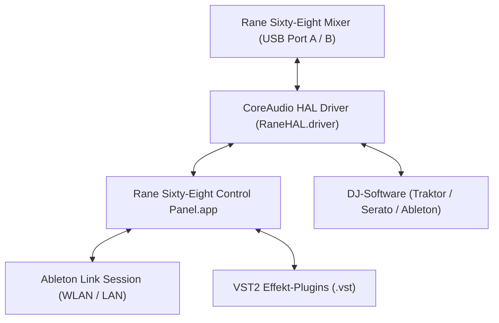
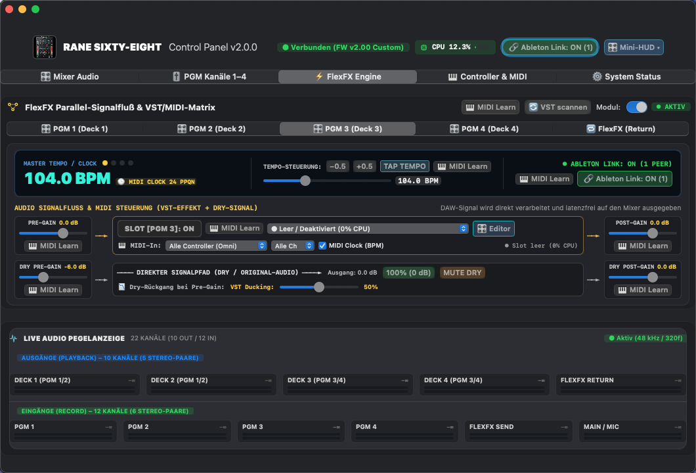
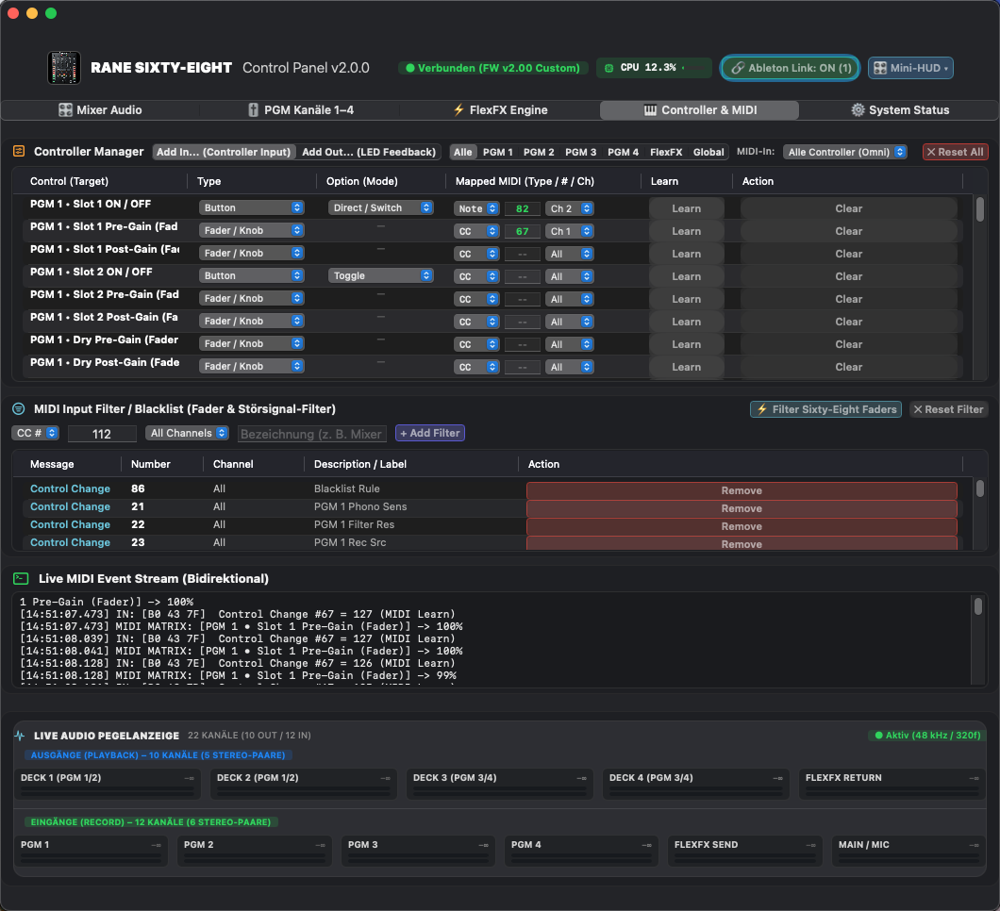
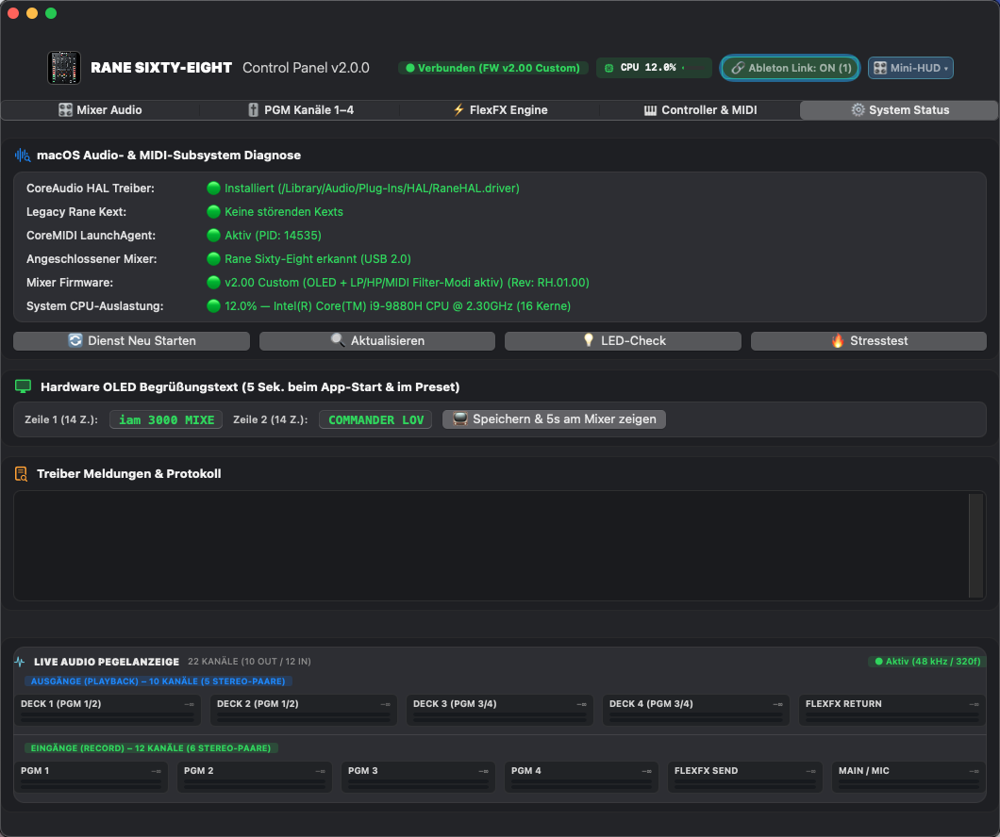

# 📖 Rane Sixty-Eight Control Panel & Treiber – Benutzerhandbuch

Willkommen zum umfassenden Benutzerhandbuch für das **Rane Sixty-Eight Control Panel** und den **CoreAudio HAL-Treiber**. Dieses Dokument führt Sie Schritt für Schritt durch alle Funktionen, Tabs, VST-Effekt-Routings und Ableton-Link-Synchronisationen.

---

## 📑 Inhaltsverzeichnis

1. [Übersicht & Schnellstart](#1-übersicht--schnellstart)
2. [Tab 1: 🎛 Mixer Audio & Globale Einstellungen](#2-tab-1-🎛-mixer-audio--globale-einstellungen)
3. [Tab 2: 🎚 PGM Kanäle 1–4 (Preamp & Phono-Setup)](#3-tab-2-🎚-pgm-kanäle-1–4-preamp--phono-setup)
4. [Tab 3: ⚡️ FlexFX Engine, VST-Plugins & Ableton Link](#4-tab-3-⚡️-flexfx-engine-vst-plugins--ableton-link)
   - [Die 1-Slot Kanal-Architektur](#die-1-slot-kanal-architektur)
   - [VST-Plugin laden und Editor öffnen](#vst-plugin-laden-und-editor-öffnen)
   - [Signalfluss, Pegel & VST-Ducking](#signalfluss-pegel--vst-ducking)
   - [Ableton Link & Beat-Synchronisation](#ableton-link--beat-synchronisation)
5. [Tab 4: 🎹 Controller & Live MIDI-Monitor](#5-tab-4-🎹-controller--live-midi-monitor)
   - [Live MIDI-Log & Filter](#live-midi-log--filter)
   - [Interaktives MIDI Learn](#interaktives-midi-learn)
6. [Tab 5: ⚙️ System Status, CPU & Hardware-Diagnose](#6-tab-5-⚙️-system-status-cpu--hardware-diagnose)
   - [Hardware-LED-Test & Selbsttests](#hardware-led-test--selbsttests)
   - [Individueller Mixer-OLED-Begrüßungstext](#individueller-mixer-oled-begrüßungstext)
7. [Mini-HUD Modus (Floating Live-Overlay)](#7-mini-hud-modus-floating-live-overlay)
8. [Setup-Guide für DJ-Software (Traktor Pro, Ableton Live, Serato)](#8-setup-guide-für-dj-software)

---

## 1. Übersicht & Schnellstart

Das Rane Sixty-Eight Control Panel ist die zentrale Schaltzentrale für Ihren Rane Sixty-Eight DJ-Mixer unter modernem macOS (macOS 11 Big Sur bis macOS 15 Sequoia).

* **Keine Kernel Extensions (Kexts):** Der Treiber läuft 100% im User-Space innerhalb von `coreaudiod`. System Integrity Protection (SIP) muss nicht deaktiviert werden.
* **22 Audiokanäle:** 10 Playback-Kanäle (Ausgänge vom Mac zum Mixer) und 12 Record-Kanäle (Eingänge vom Mixer in den Mac) bei nativer 48.000 Hz / 32-Bit Float Auflösung.

---

## 2. Tab 1: 🎛 Mixer Audio & Globale Einstellungen

Hier konfigurieren Sie die Hardware-Eigenschaften des Mixers und die CoreAudio-Puffergröße.

### Kernfunktionen:
1. **Master Kopfhörer-EQ (Phones Tone):**
   * Regelt `Low Tone` (-6 dB bis +6 dB) und `High Tone` (-6 dB bis +6 dB) des Kopfhörerverstärkers.
2. **Hardware-Display & Beleuchtung:**
   * **LCD Kontrast:** Schieberegler zur Anpassung des FlexFX-Displays am Mixer.
   * **Mixer-Hintergrundbeleuchtung:** Ein-/Ausschalten der beleuchteten Knöpfe und LED-Taster.
3. **USB 6 Record Source:**
   * Bestimmt, welches Signal auf USB-Kanal 11–12 zum Mac übertragen wird (z. B. `Main Mix`, `Mic` oder `Aux`).
4. **Puffergröße & Latenz (Buffer Frame Size):**
   * Einstellbar von **64** bis **4096 Samples**.
   * *Empfehlung für Live-DJing:* **256 Samples** (5,3 ms bei 48 kHz) oder **512 Samples** (10,6 ms).
5. **Live Audio-Pegelanzeige (Bottom Bar):**
   * Zeigt permanent in allen Tabs die Ein- und Ausgangspegel aller 22 Kanäle in Echtzeit an.

---

## 3. Tab 2: 🎚 PGM Kanäle 1–4 (Preamp & Phono-Setup)

Konfiguration der Vorverstärker für Plattenspieler (Phono) und CD/Line-Zuspieler.

### Kernfunktionen:
1. **Phono-Vorverstärker Empfindlichkeit:**
   * Einstellbare Vorverstärkung in dB für Tonabnehmer mit niedrigerem oder höherem Ausgangspegel.
2. **Eingangskapazität (Phono Resonance):**
   * Anpassung der Kapazität (in Picofarad, pF) zur perfekten Frequenzgang-Optimierung Ihrer Tonabnehmer (z. B. Shure M44-7, Ortofon Concorde).
3. **Hardware-Statusanzeige:**
   * Zeigt den aktuellen Zustand der physischen Schalter auf der Rückseite (`LINE` vs. `PHONO`) und der Drehschalter (`USB 1–4`, `PH/CD`, `AUX`) sowie der Crossfader-Zuweisung (`CROSSFADER A / POST / B`) an.

---

### 🎛 Exklusive Hardware-Filter-Modi (PGM 1–4) – Custom Firmware v2.00

In der originalen Werks-Firmware ist der physische Filter-Drehregler jedes Kanalzugs fest an einen kombinierten Dual-Filter gebunden (Links = Low-Pass, 12 Uhr = Neutral, Rechts = High-Pass).  
Mit der **Custom-Firmware v2.00** können Sie das Verhalten des Hardware-DSP-Filters für jeden der 4 Kanalzüge im laufenden Betrieb über das Dropdown **„Filter-Modus (Poti)“** individuell umschalten:

| Modus | Name | Verhalten des physischen Kanal-Filter-Drehreglers | Anwendungsbereich im DJ-Set |
| :---: | :--- | :--- | :--- |
| **0** | **Normal (LP + HP)** | Originaler kombinierter Dual-Filter: 12-Uhr-Mittelrastung ist Neutral (Bypass), nach links Low-Pass (0..63), nach rechts High-Pass (65..127). | Klassisches Allround-Club-Mixing. |
| **1** | **Nur Low-Pass (270°)** | Der **gesamte 270°-Drehbereich** regelt ausschließlich den Low-Pass-Filter mit **doppelter Präzision** (Rechtsanschlag = Neutral/Offen, Linksanschlag = maximaler LPF bis 0 Hz). | Feinfühlige Bass-Cuts und butterweiche Übergänge ohne Gefahr, versehentlich in den High-Pass zu rutschen. |
| **2** | **Nur High-Pass (270°)** | Der **gesamte 270°-Drehbereich** regelt ausschließlich den High-Pass-Filter mit **doppelter Präzision** (Linksanschlag = Neutral/Offen, Rechtsanschlag = maximaler HPF bis 20 kHz). | Dramatische Buildups und Sweeps mit maximaler dynamischer Auflösung über den gesamten Drehweg. |
| **3** | **Filter Aus (Reiner MIDI-Controller)** | Der Hardware-DSP-Filter wird fest auf **Neutral (64 / Bypass)** verriegelt. Der physische Drehregler sendet weiterhin volle 0..127 USB-MIDI-Werte an den Mac. | **Effekt-Mapping in Traktor / Serato / Ableton:** Mappen Sie den Regler auf Software-Effekte (Delays, Glitch, Beatmasher), ohne das analoge/digitale Mixer-Audio auf der Hardware zu filtern! |

> [!TIP]
> **Echtzeit-Umschaltung:** Das Control Panel überträgt den Modus per MIDI-SysEx (Opcode `0x06`) ohne Audio-Unterbrechung an den Mixer. Die gewählten Modi werden in den Einstellungen gespeichert und beim nächsten Start automatisch wiederhergestellt.

---

## 4. Tab 3: ⚡️ FlexFX Engine, VST-Plugins & Ableton Link

Das Herzstück für moderne DJ-Sets: Binden Sie beliebige Studio-Effekte (Delays, Reverbs, Filter) direkt in die Kanalzüge ein und synchronisieren Sie diese über das Ableton Link Protokoll.

### Die 1-Slot Kanal-Architektur
Jeder Kanalzug verfügt über genau einen dedizierten, latenzfreien VST-Slot:
* **Kanal 1–4 (PGM 1..4):** Schaltet den VST-Effekt direkt als Kanal-Insert auf Deck 1 bis Deck 4.
* **Kanal 5 (FlexFX Return):** Verarbeitet das Return-Signal des analogen FlexFX-Hardware-Send-Busses des Mixers.

### VST-Plugin laden und steuern
1. Klicken Sie auf den gewünschten Kanalreiter (z. B. `PGM 1 (Deck 1)`).
2. Wählen Sie im Dropdown-Menü das gewünschte VST2-Plugin aus.
   * *Tipp:* Mit dem Button **„🔄 VST scannen“** können Sie neu installierte Plugins in `/Library/Audio/Plug-Ins/VST/` jederzeit neu einlesen.
3. Über den Button **„🎛 Editor“** lässt sich bei Bedarf das native Plugin-Bedienfenster öffnen.

### Signalfluss, Pegel & VST-Ducking
* **Pre-Gain & Post-Gain:** Regeln den Eingangspegel in den Effekt und den Ausgangspegel zurück in den Kanal.
* **Direkter Signalpfad (Dry):** Gewährleistet, dass das Original-Musiksignal stets 100% sauber und ohne Phasenprobleme erhalten bleibt.
* **VST Ducking Slider:** Regelt automatisch das Dry-Signal herunter, wenn der Effekt-Pre-Gain aufgedreht wird (intelligente Cross-Fade-Dynamik).

### Ableton Link & Beat-Synchronisation
* **Link Aktivieren:** Klicken Sie auf den Button **`🔗 Ableton Link: ON`**. Sobald ein anderes Gerät oder eine App im selben WLAN/Netzwerk aktiv ist, leuchtet der Badge grün: **`● ABLETON LINK: ON (1 PEER)`**.
* **Phasenstabilität:** Das Mixer-OLED und die 4 Beat-LEDs richten sich über das Link-Beatgrid automatisch am 4/4-Takt aus.
* **Hardware BPM-Sync:** Der Mixer empfängt das Link-Tempo automatisch; auf dem Mixer-OLED blinkt der Asterisk `*` im Takt der Musik.

---

## 5. Tab 4: 🎹 Controller & Live MIDI-Monitor

Das Control Panel empfängt und visualisiert alle MIDI-Nachrichten des Rane Sixty-Eight.

### Live MIDI-Log & Filter
* **Kanal- und Event-Filter:** Blenden Sie gezielt bestimmte MIDI-Kanäle (Ch 1–16) oder Nachrichtentypen (Note-On, Control Change, Pitch Bend) ein oder aus.
* **Auto-Scroll & Pause:** Halten Sie den Log an, um gesendete Werte von Fadern, Knöpfen oder Encodern präzise zu untersuchen.

### Interaktives MIDI Learn
Sie können jeden virtuellen Button und Regler der App direkt auf Tasten oder Knöpfe des Rane Sixty-Eight mappen:
1. Klicken Sie auf das **„🎹 MIDI Learn“**-Badge neben dem gewünschten Parameter (das Badge leuchtet gelb auf).
2. Bewegen oder drücken Sie das gewünschte Bedienelement am Mixer.
3. Das Mapping wird sofort gespeichert und aktiv geschaltet.

---

## 6. Tab 5: ⚙️ System Status, CPU & Hardware-Diagnose

Umfassende Diagnose- und Überwachungswerkzeuge für maximale Stabilität im Live-Betrieb.

### Hardware-LED-Test & Selbsttests
* **LED Chaser Lichtcheck:** Testet alle LEDs und Hintergrundbeleuchtungen der Mixer-Oberfläche nacheinander.
* **USB-Stresstest:** Überprüft die Bandbreite und Puffer-Integrität des USB-Busses unter Maximallast.

### Individueller Mixer-OLED-Begrüßungstext
Im Feld **„Mixer OLED Begrüßungstext“** können Sie einen zweizeiligen Text (jeweils 14 Zeichen) eingeben (z. B. `DJ RESIDENT` / `READY TO ROCK`). Dieser wird beim Einschalten der App für 5 Sekunden auf dem physikalischen Mixer-Display angezeigt.

---

## 7. Mini-HUD Modus (Floating Live-Overlay)

Wenn Sie während des Auflegens mit Traktor Pro, Serato DJ oder Ableton Live den gesamten Bildschirm für Ihre Decks benötigen, können Sie das Control Panel in das **Mini-HUD** minimieren:

1. Klicken Sie oben rechts im Header auf **„🎛 Mini-HUD ▾“**.
2. Das große Fenster wird ausgeblendet und ein schlankes, frei verschiebbares Floating-Panel dockt sich an:

* **Features im Mini-HUD:**
  * Live BPM-Anzeige & Takt-Punkte.
  * Ableton Link Verbindungsstatus.
 
  * Mit **`⤢ FULL`** kehren Sie jederzeit sofort in das vollständige Control Panel zurück.

---

## 8. Setup-Guide für DJ-Software

### Traktor Pro 3 / 4
1. **Audio Device auswählen:** In *Preferences → Audio Setup* als Audio Device **„Rane Sixty-Eight“** wählen.

2. **Output Routing:**
   * *Deck A:* Output 1 / 2 (PGM 1)
   * *Deck B:* Output 3 / 4 (PGM 2)
   * *Deck C:* Output 5 / 6 (PGM 3)
   * *Deck D:* Output 7 / 8 (PGM 4)
3. **Flüssige Waveforms:** Falls die Waveform auf externen Bildschirmen ruckelt, stellen Sie in den macOS-Systemeinstellungen die Bildwiederholrate des Monitors auf **60 Hz** ein.

### Ableton Live
1. In *Einstellungen → Audio* den **Rane Sixty-Eight** als Audio-Eingangs- und Ausgangsgerät festlegen.
2. Im Control Panel oben rechts auf **`🔗 Ableton Link: ON`** klicken und in Ableton Live oben links ebenfalls **`Link`** aktivieren. Beide Programme synchronisieren Tempo und Takt sofort über das lokale Netzwerk.

---

*Entwickelt mit Leidenschaft für die Rane Sixty-Eight DJ-Community.*
